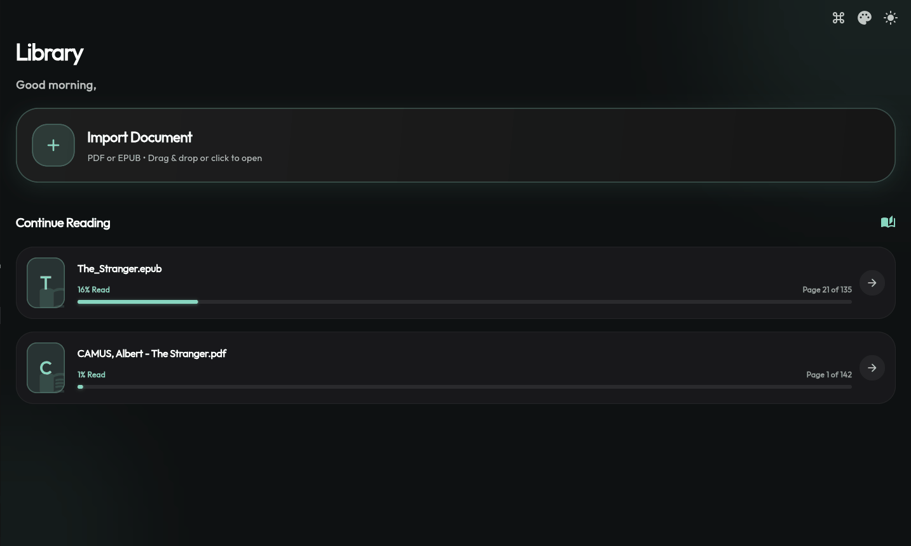
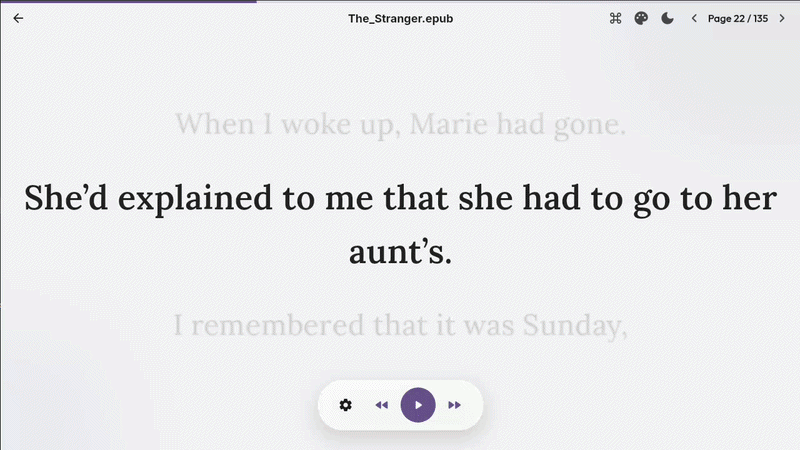
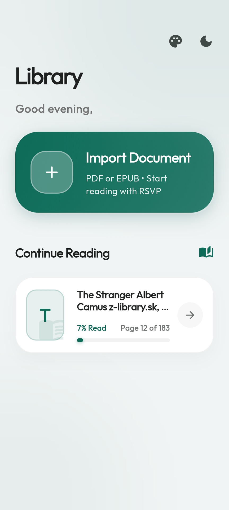
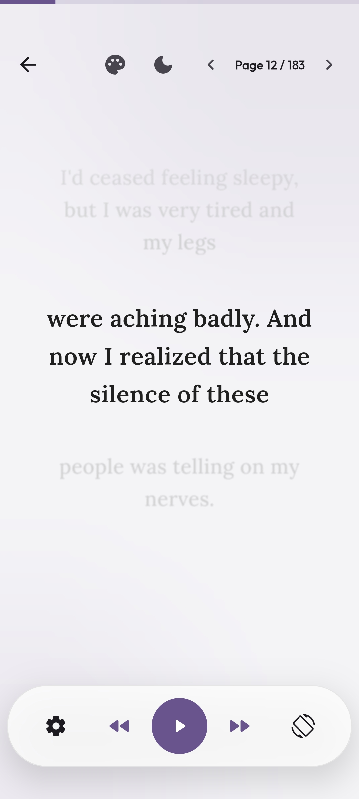

# Linea

> Minimalist, line-paced reading designed to eliminate distraction, boost focus and help in increasing reading speed.

Linea is a focused reading application that parses PDF and EPUB documents into structured, line-by-line text blocks. By delivering text sequentially at user-controlled time intervals, Linea helps readers maintain focus, reduce eye fatigue, and maintain a steady reading rhythm.

---

## Core Concept: Rapid Serial Visual Presentation (RSVP)

Linea utilizes **Rapid Serial Visual Presentation (RSVP)** and **Paced Reading** techniques. Traditional reading requires continuous horizontal scanning and line-tracking, which often leads to distraction and regression (re-reading lines).

Linea extracts the text from your documents behind the scenes, indexing it by page and line, and presents it sequentially at your custom pace — ranging anywhere from 2 to 6 seconds per line.

> **Note:** Linea is **not ideal** for complex comprehension, deep studying, or reviewing dense information.

---

## Key Features

- **Document Extraction:** Automatic line and page parsing for PDF and EPUB formats.
- **Customizable Interval Engine:** Adjustable line-switch speeds tailored to individual reading rates.
- **Distraction-Free Interface:** Pure text presentation free from page clutter, columns, and marginalia.
- **Theme Customization:** Choose from multiple color palettes to suit your reading environment.
- **Dark Mode:** Seamlessly toggle between light and dark themes.
- **Fullscreen Reading:** Immersive fullscreen mode for an uninterrupted reading experience.
- **Cross-Platform Layouts:** Optimized, responsive design for desktop and mobile reading.
- **Progress Tracking:** Instant line-level position retention across sessions.

---

## Application Showcase

### Desktop

<div align="center">

**Dashboard**



**Reader**



</div>

### Mobile

<div align="center">

**Dashboard**



**Reader**



**Fullscreen Reader**


</div>

---

## Download & Installation

Installer and pre-built binaries for desktop and mobile devices are available on the official releases page.

[**Get Latest Release →**](https://github.com/Ankit-692/linea/releases)

### Supported Platforms

| Platform | Support |
|----------|---------|
| macOS    | ✅      |
| Windows  | ✅      |
| Linux    | ✅      |
| Android  | ✅      |
| iOS      | ✅      |

### Note for macOS Users

Since Linea isn't notarized by Apple (no paid developer account), macOS will block it on first open.

**To run it:**

- Right-click the **app → Open → click Open again** in the dialog, **OR**
- Open Terminal and run:

```bash
xattr -cr /Applications/Linea.app
```

---

## How It Works

1. **Upload:** Open any standard `.pdf` or `.epub` document within Linea.
2. **Extraction:** The internal parser breaks down the raw content into structured line indices.
3. **Pacing:** Select your preferred interval timing (e.g., 3.5 seconds per line).
4. **Read:** Press play to begin auto-paced reading without manual scrolling.

---

## License

Distributed under the MIT License. See [`LICENSE`](LICENSE) for details.

